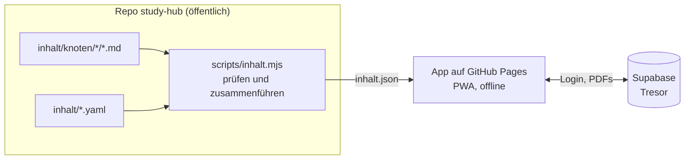
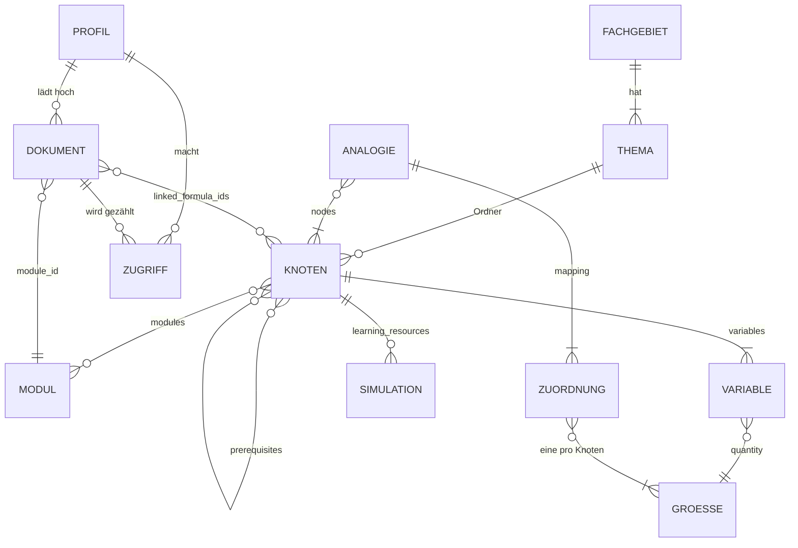
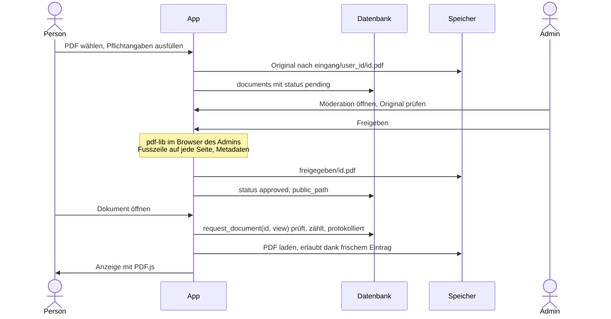

# Architektur

Ergebnis von Aufgabe 1 (28.10.2026): Datenmodell, Relationen, Speicher mit Wasserzeichen und Aufbau des Frontends,
noch ohne UI-Code. Was gilt: zuerst die Entscheide in `AUFGABEN.md`, dann dieses Dokument, dann `BRIEFING.md`.

## Überblick

| Teil | Was | Wo | Server |
|---|---|---|---|
| Formelbuch | Formel-Knoten, Grössen, Themen, Module, Analogien, Simulationen, Lernhilfen | Dateien im Repo, App auf GitHub Pages (PWA, offline) | keiner |
| Dokumenten-Tresor | PDFs: Altklausuren, Skripte, Zusammenfassungen, Übungsblätter | eigenes Supabase-Projekt | Datenbank, Speicher, Login |



Single Source of Truth: Jede Formel, jede Grösse und jede Analogie steht genau einmal im Repo. Was sich daraus
ableiten lässt (Fachgebiet, Rückverweise, Analogien eines Knotens, Formelsammlung eines Moduls), berechnet die
Prüfung beim Build und schreibt es in `inhalt.json`.

## 1. Inhalte im Repo

### Ablage

```text
inhalt/
  themen.yaml          Fachgebiete und ihre Themen
  groessen.yaml        Grössen mit Name, Zeichen und Einheit
  module.yaml          Module (Fächer) mit Simulationswerkzeugen
  analogien.yaml       gleiche Mathematik in verschiedenen Fachgebieten
  knoten/
    gleichstrom/
      ohmsches-gesetz.md       ein Formel-Knoten: ID = Dateiname, Thema = Ordner
    waermetransport/
      waermewiderstand.md      eigene Bilder und Modelle liegen neben dem Knoten
schema/                JSON-Schemas zu allen Dateien (für die Prüfung und den Editor)
scripts/inhalt.mjs     prüft alles und erzeugt inhalt.json
```

Tipp: VS Code mit der Erweiterung «YAML» (Red Hat) schlägt in den `.yaml`-Dateien die Felder vor und markiert
Fehler sofort. Die erste Zeile `# yaml-language-server: $schema=...` verbindet die Datei mit ihrem Schema.

### Formel-Knoten (FormulaNode)

Beispiel `inhalt/knoten/gleichstrom/ohmsches-gesetz.md`:

```markdown
---
title: Ohmsches Gesetz
latex_expression: 'U = R \cdot I'
forms:
  - 'I = \frac{U}{R} = G \cdot U'
  - 'G = \frac{1}{R}'
level: 1
variables:
  - { symbol: U, quantity: spannung }
  - { symbol: R, quantity: widerstand }
  - { symbol: I, quantity: strom }
  - { symbol: G, quantity: leitwert }
modules: [et-grundlagen]
sources:
  - { title: 'Lernlabor, Theorie Gleichstrom', url: 'https://simonbruder-hub.github.io/apps/lernlabor/app/' }
---
Bei einem linearen Widerstand ist der Strom proportional zur Spannung. Die Kennlinie $I(U)$ ist eine
Gerade durch den Ursprung mit der Steigung $G = 1/R$.
```

| Feld | Pflicht | Inhalt |
|---|---|---|
| ID | | Dateiname ohne `.md`: nur `a-z`, `0-9` und `-`, ohne Umlaute (`waermewiderstand`) |
| Thema | | Ordner, muss in `themen.yaml` stehen; daraus folgt das Fachgebiet |
| `title` | ja | Name des Knotens |
| `latex_expression` | ja | Hauptformel in LaTeX, ohne `$`; in YAML in einfachen Anführungszeichen |
| `forms` | | weitere Formen (umgestellt, Spezialfälle), kommen mit in die Formelsammlung |
| `level` | ja | 1 Grundlagen, 2 Vertiefung, 3 Spezialisierung |
| `variables` | ja | pro Zeichen: `symbol` (LaTeX), `quantity` (ID aus `groessen.yaml`), optional `meaning` |
| `modules` | | IDs aus `module.yaml` |
| `prerequisites` | | IDs der Knoten, die man vorher kennen muss |
| `learning_resources` | | `simulations`, `videos` und `links` (je `title`, `url`), `prompt` (eigene KI-Vorlage) |
| `sources` | | `title`, `author`, `year`, `url`; Pflicht, wenn der Inhalt auf einer Vorlage beruht |
| Text | | unter dem Kopf: Erklärung als Markdown mit `$...$` und `$$...$$`; nicht in der Formelsammlung |

Simulationen (`learning_resources.simulations`), das genaue Format pro Werkzeug folgt in Aufgabe 4:

| `tool` | braucht | Bedeutung |
|---|---|---|
| `lernlabor` | `example` | Beispiel im eigenen Baukasten, z. B. `rc` |
| `python` | `file` | Skript neben dem Knoten, läuft im Browser (Pyodide) |
| `falstad` | `circuit` | Schaltung als Text, nur für Bauteile, die dem Lernlabor fehlen |
| `plecs`, `simulink` | `file` | Modell neben dem Knoten, dazu `image` (Schaltung), `result` (Ergebnis) und `params` |

Ins Repo kommen nur eigene Modelle, keine Dateien der Dozenten.

### Abweichungen vom Briefing

- `id` und `disciplines` stehen nicht im Kopf. Dateiname und Ordner legen sie schon fest, eine zweite Angabe
  könnte widersprechen. Jeder Knoten hat genau ein Fachgebiet. Dieselbe Mathematik in einem anderen Fachgebiet ist
  ein eigener Knoten, verbunden über eine Analogie.
- `analogies` stehen nicht im Knoten, sondern einmal in `analogien.yaml`. Sonst müsste man jede Analogie in beiden
  Knoten pflegen. Dafür hat jede Analogie eine Zuordnung der Grössen, die die App als Tabelle zeigt.
- `variables` verweisen auf eine Grösse. Name und Einheit stehen nur in `groessen.yaml`, so ist jede Einheit
  überall gleich geschrieben.
- Simulationen haben ein Werkzeug-Feld statt nur eines Falstad-Strings.
- Neu sind `forms` für die Formelsammlung und `sources` für die Quellenpflicht.

### Register

```yaml
# themen.yaml: Fachgebiet → Themen; jedes Thema ist ein Ordner in inhalt/knoten/
elektrotechnik:
  title: Elektrotechnik
  topics: { gleichstrom: Gleichstrom, wechselstrom: Wechselstrom, schaltvorgaenge: Schaltvorgänge }

# groessen.yaml: jede Grösse einmal; Zeichen und Einheit in LaTeX
waermewiderstand: { name: Wärmewiderstand, symbol: 'R_{th}', unit: 'K/W' }

# module.yaml: Module mit Werkzeugen (vorerst ein Beispiel)
et-grundlagen: { title: Grundlagen der Elektrotechnik, tools: [lernlabor, python] }

# analogien.yaml: Knoten mit gleicher Mathematik, Grössen pro Zeile in der Reihenfolge von nodes
ohm-thermisch:
  title: Widerstand gegen einen Fluss
  nodes: [ohmsches-gesetz, waermewiderstand]
  mapping:
    - [spannung, temperaturdifferenz]
    - [strom, waermestrom]
    - [widerstand, waermewiderstand]
```

### Regeln

Die Prüfung `npm run inhalt` läuft lokal und in der CI. Sie bricht ab bei:

1. Schema: Pflichtfeld fehlt, Wert nicht erlaubt, unbekanntes Feld (so fallen Tippfehler wie `prerequisite` auf).
2. Ablage: Knoten nicht unter `knoten/<thema>/<id>.md`, ID ungültig oder doppelt, Thema fehlt in `themen.yaml`.
3. Verweise: Modul, Voraussetzung, Grösse, Knoten einer Analogie oder Datei einer Simulation gibt es nicht.
4. Kreis in den Voraussetzungen (A braucht B, B braucht A).
5. Analogie: Zeile ohne eine Grösse pro Knoten, oder der Knoten hat keine Variable dieser Grösse.
6. LaTeX, das mit KaTeX nicht rendert: Hauptformel, Formen, Zeichen, Einheiten und Formeln im Text.
7. Schreibregeln: scharfes S oder Gedankenstrich.

Warnungen lassen die CI grün: Voraussetzung mit höherer Stufe als der Knoten, unbenutzte Grösse, Hinweise von KaTeX
(z. B. ein Umlaut direkt in einer Formel).

IDs bleiben stabil, denn Links, Lesezeichen und Dokumente im Tresor hängen daran. Muss eine ID doch ändern, zeigt
die Prüfung alle Stellen im Repo, die anzupassen sind.

### inhalt.json

`npm run inhalt -- --json dist/inhalt.json` schreibt die Daten für die App:

```text
disciplines   Fachgebiet → Titel, Themen
topics        Thema → Titel, Fachgebiet
quantities    wie groessen.yaml
modules       wie module.yaml
analogies     wie analogien.yaml
nodes         alle Knoten, sortiert nach Thema, Stufe und Titel, mit allen Feldern und zusätzlich:
              id, file, topic, discipline, required_by (wer baut darauf auf), analogies (IDs)
```

Fehlende Listen sind leer statt undefiniert, die App muss das nicht prüfen. In Aufgabe 2 wird der Text dabei zu HTML
(Markdown und KaTeX schon beim Build), die App zeigt ihn nur noch an.

## 2. Relationen



Die Enden zeigen die Anzahl: `||` genau eins, `o{` null bis viele, `|{` eins bis viele. DOKUMENT, PROFIL und
ZUGRIFF sind Tabellen in Supabase, alles andere sind Dateien im Repo. Die Verbindung läuft über die IDs als Text,
ohne Fremdschlüssel, denn die Knoten liegen nicht in der Datenbank. Beim Hochladen bietet die App nur IDs an, die es
gibt.

## 3. Dokumenten-Tresor

Umsetzung in Aufgabe 6. Login nur mit der Mail-Adresse der Hochschule, danach schaltet Simon jede Person frei. Ohne
Login und Freischaltung ist im Tresor nichts sichtbar. Formelbuch und Prüfungs-Modus bleiben offen.

### Tabellen

`profiles`, eine Zeile pro Person:

| Spalte | Typ | Regel |
|---|---|---|
| `user_id` | uuid | Schlüssel, gleich `auth.users.id` |
| `display_name` | text | |
| `role` | `student` oder `admin` | Standard `student` |
| `status` | `pending`, `approved` oder `blocked` | Standard `pending`, Admin schaltet frei |
| `created_at` | timestamptz | |

`documents`, ein Eintrag pro PDF (DocumentNode):

| Spalte | Typ | Regel |
|---|---|---|
| `id` | uuid | Schlüssel |
| `title` | text | Pflicht |
| `document_type` | `altklausur`, `skript`, `zusammenfassung`, `uebungsblatt` | Pflicht |
| `module_id` | text | Pflicht, ID aus `module.yaml` |
| `linked_formula_ids` | text[] | Knoten, die man zum Lösen braucht; GIN-Index für «welche Dokumente nutzen diesen Knoten» |
| `source_author`, `source_year` | text, integer | Pflicht |
| `source_semester`, `source_institution`, `source_lecturer` | text | z. B. `HS25`, Hochschule, Dozent |
| `license` | `eigenes-werk`, `erlaubnis`, `offene-lizenz` | Pflicht |
| `license_note` | text | z. B. «Erlaubnis per Mail vom 3.11.2026» |
| `status` | `pending`, `approved`, `rejected` | Standard `pending` |
| `uploaded_by` | uuid | Verweis auf `profiles`, immer die angemeldete Person |
| `upload_date` | timestamptz | Standard jetzt |
| `reviewed_by`, `reviewed_at`, `review_note` | | Freigabe oder Ablehnung |
| `original_path` | text | Original im Bucket `eingang` |
| `public_path` | text | Fassung mit Wasserzeichen im Bucket `freigegeben`, erst nach der Freigabe |
| `page_count`, `size_bytes`, `sha256` | | Anzeige, Grösse begrenzen, doppelte Uploads erkennen |

`source_metadata` aus dem Briefing ist auf einzelne Spalten verteilt. So erzwingt die Datenbank die Pflichtangaben
selbst (`not null`, `check`).

`access_log`, ein Eintrag pro Zugriff: `id`, `user_id`, `document_id`, `action` (`view`, `download`, `print`),
`created_at`, Index auf `user_id` und `created_at`.

### Rechte (Row Level Security)

| Wer | darf |
|---|---|
| ohne Login | im Tresor nichts |
| angemeldet, Status `pending` | das eigene Profil lesen |
| freigeschaltet | freigegebene Dokumente lesen, eigene Uploads sehen, hochladen (nur mit `status` `pending` und sich selbst als `uploaded_by`) |
| Admin | alles: Personen freischalten, Dokumente prüfen, freigeben, ablehnen, löschen |

Speicher, zwei private Buckets:

- `eingang`: Hochladen nur in den eigenen Ordner `<user_id>/`, nur PDF, höchstens 20 MB. Lesen nur der Admin.
- `freigegeben`: Schreiben nur der Admin. Lesen nur freigeschaltete Personen, und nur mit einem Eintrag in
  `access_log` zu diesem Dokument aus den letzten 2 Minuten (siehe Rate-Limit).

### Ablauf mit Wasserzeichen



Wasserzeichen mit `pdf-lib`:

- Inhalt: Fusszeile klein und grau auf jeder Seite, z. B. «Quelle: M. Muster, Grundlagen der Elektrotechnik, HS25 |
  Bereitgestellt über Study Hub». Dazu Titel, Autor und Schlagwörter in den Metadaten des PDFs.
- Wann und wo: einmal bei der Freigabe, im Browser des Admins. `pdf-lib` läuft im Browser, darum braucht es keinen
  eigenen Server und keine Edge Function mit ihrer knappen Rechenzeit. Das ist sicher genug, weil nur der Admin in
  `freigegeben` schreiben darf: Wer hochlädt, kann das Wasserzeichen nicht umgehen.
- Das Original bleibt in `eingang`, nur für den Admin. So lässt sich das Wasserzeichen neu erzeugen, wenn sich der
  Text ändert.
- Stolpersteine: Verschlüsselte PDFs kann `pdf-lib` nicht ändern, darum schon beim Hochladen ablehnen. Gedrehte
  Seiten und Seiten mit Rand (CropBox) beachten. Die Standardschrift Helvetica kennt die Umlaute, aber nicht jedes
  Zeichen (z. B. griechische), den Text der Fusszeile darum bereinigen oder eine Schrift einbetten.
- Später, falls nötig: eine persönliche Zeile beim Herunterladen («Abgerufen von ... am ...»). Die muss auf einem
  Server entstehen (Edge Function), weil man dem Browser der Person nicht trauen kann.

### Rate-Limit

- Jeder Zugriff läuft über die Datenbankfunktion `request_document(document_id, action)` (`security definer`). Sie
  prüft Login, Freischaltung, Freigabe des Dokuments und die Grenze (Vorschlag: 60 Ansichten und 10 Downloads oder
  Drucke pro Stunde) und schreibt den Zugriff in `access_log`.
- Die Regel für den Bucket `freigegeben` erlaubt das Lesen nur mit einem frischen Eintrag. Ein Skript kann den Zähler
  also nicht umgehen.
- So geht es ohne eigenen Server: nur Tabellen, Regeln und eine Funktion in Supabase.

Ehrlich gesagt: Was der Browser anzeigt, lässt sich immer kopieren. PDF.js zeigt das Dokument ohne Download-Knopf,
lädt die Datei dafür aber trotzdem. Login, Freischaltung, Wasserzeichen und Rate-Limit schrecken ab und halten die
Quelle sichtbar, verhindern aber nicht alles.

### Login

- Supabase Auth mit einem Code per Mail (6 Ziffern, `{{ .Token }}` in der Mail-Vorlage) statt eines Links. Das geht
  auch in der installierten PWA und ohne Weiterleitung, das Problem mit der 404-Seite aus Taktwerk fällt weg.
- Nur Adressen der Hochschule: Ein Auth Hook «Before User Created» prüft die Domain. Danach steht die Person auf
  `pending`, bis Simon sie freischaltet.
- Grenzen des Gratis-Plans (vor Aufgabe 6 nachprüfen): 1 GB Speicher, 50 MB pro Datei, 500 MB Datenbank. Für den
  Anfang reicht das.

## 4. Frontend

Gleicher Stack wie Lernlabor und Kochbuch: Vite, Preact mit Signals, TypeScript, KaTeX, PWA und Hash-Routing
(`#/pfad?schluessel=wert`, läuft auf GitHub Pages ohne Server).

### Adressen

| Adresse | Ansicht | Aufgabe |
|---|---|---|
| `#/` | Start: Suche, Fachgebiete, zuletzt angesehen | 2 |
| `#/explorer?thema=gleichstrom&stufe=2` | Explorer: Fachgebiet, Thema, Knoten; Stufen aufklappen | 2 |
| `#/k/ohmsches-gesetz` | Knoten: Formel, Variablen, Text, Voraussetzungen, baut darauf auf, Analogien, Lernhilfen, Quellen | 2, 5 |
| `#/pruefung?modul=et-grundlagen` | Formelsammlung eines Moduls, bereit zum Drucken | 2 |
| `#/pruefung?k=ohmsches-gesetz,rc-laden` | eigene Auswahl; die Adresse lässt sich teilen und speichern | 2 |
| `#/labor?bsp=rc` | Lernlabor-Baukasten | 3 |
| `#/tresor`, `#/tresor/d/<id>`, `#/tresor/neu`, `#/tresor/moderation` | Tresor | 6 |

### Ordner und Komponenten

```text
src/
  main.tsx, App.tsx, router.ts   Start, Rahmen mit Navigation, Hash-Routing (wie Lernlabor)
  data/
    types.ts                     Typen zu inhalt.json (FormulaNode, Quantity, Analogy, ...)
    content.ts                   lädt inhalt.json einmal, als Signal
    graph.ts                     Weg zu den Grundlagen, baut darauf auf, Formelsammlung eines Moduls
    search.ts                    Suche über Titel, Zeichen und Grössen
  ui/                            kleine Bausteine, überall gleich
    Tex.tsx                      KaTeX (aus dem Lernlabor)
    Formula.tsx                  Hauptformel mit Formen
    VariableTable.tsx            Zeichen, Bedeutung, Einheit
    LevelBadge.tsx, NodeLink.tsx, NodeCard.tsx
  views/
    Home.tsx
    explorer/    Explorer.tsx, TopicTree.tsx, LevelFilter.tsx
    node/        NodePage.tsx, Prerequisites.tsx, Analogies.tsx, Resources.tsx, Sources.tsx
    exam/        ExamPage.tsx, Selection.tsx, PrintSheet.tsx, print.css, später texExport.ts
  learn/         Aufgabe 5: PromptButton.tsx, prompt.ts, Videos.tsx, SliderGraph.tsx
  sim/           Aufgaben 3 und 4: Simulation.tsx wählt nach tool; Rechenkern und Baukasten aus dem Lernlabor
  vault/         Aufgabe 6, lädt erst beim Öffnen: supabase.ts, Login.tsx, DocumentList.tsx,
                 PdfViewer.tsx (PDF.js), Upload.tsx, Moderation.tsx, watermark.ts (pdf-lib)
  styles/        app.css
```

### Entscheide im Frontend

- Daten: `inhalt.json` entsteht beim Build und ist Teil der App. Die PWA speichert sie, darum läuft das Formelbuch
  offline. Wird die Datei zu gross, kommt sie pro Fachgebiet in eine eigene Datei.
- Explorer: zuerst ein Baum statt eines grossen Netzgraphen, das ist lesbarer und braucht keine schwere Bibliothek.
  Das Netz zeigt die Knotenseite: Voraussetzungen, «baut darauf auf» und Analogien. Später vielleicht eine kleine
  Ansicht der direkten Nachbarn als SVG.
- Prüfungs-Modus: Auswahl per Modul oder eigener Liste. Druck mit CSS `@media print` im Raster mit 2 bis 3 Spalten,
  nur Titel, Hauptformel, Formen und Variablen, ohne Text und Lernhilfen. Später ein Export als `.tex` für Overleaf
  aus denselben Daten.
- Simulation: eine Komponente wählt nach `tool`. Lernlabor eingebettet, Python mit Pyodide (lädt erst bei Bedarf),
  Falstad als `iframe`, PLECS und Simulink als Bild der Schaltung mit Parametern, Ergebnis und Modell zum
  Herunterladen.
- KI-Prompt: eine Standardvorlage mit Platzhaltern (`{title}`, `{latex}`, `{level}`, `{variables}`), pro Knoten mit
  `learning_resources.prompt` überschreibbar.
- Tresor: ein eigener Teil, den Vite in ein separates Paket packt. Supabase, PDF.js und `pdf-lib` laden erst, wenn
  jemand den Tresor öffnet. Das Formelbuch bleibt klein und braucht kein Netz.

## 5. Nächste Aufgaben

| Aufgabe | aus diesem Entwurf |
|---|---|
| 2 | App mit dieser Struktur, Text beim Build als HTML, echte Module und erste Themen nach den Vorlagen, Explorer, Knotenseite, Prüfungs-Modus, Workflow für GitHub Pages |
| 3 | Lernlabor nach `src/sim/`, Theorie in Knoten, Beispiele über `tool: lernlabor` an die Knoten; KaTeX dabei von 0.16 auf 0.18 |
| 4 | Werkzeuge pro Modul in `module.yaml`, Format pro Werkzeug genauer, zwei Beispiele |
| 5 | Prompt-Knopf, Regler mit Graph, Videos und Links |
| 6 | `supabase/schema.sql` nach Abschnitt 3, mit Tests der Regeln wie bei Taktwerk |
