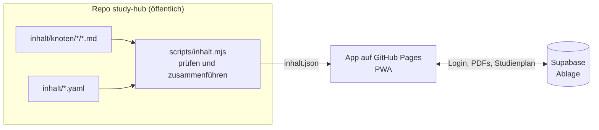
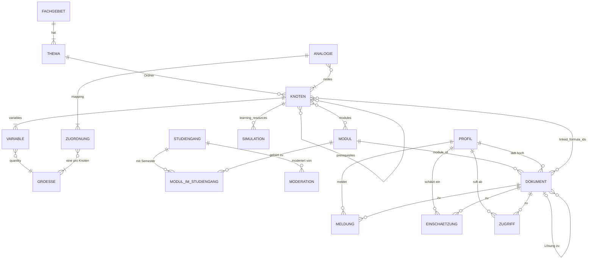
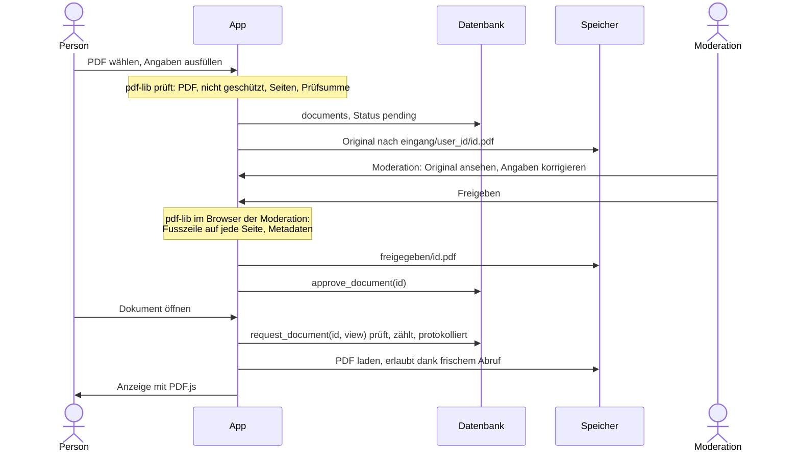

# Architektur

Ergebnis von Aufgabe 1 (28.10.2026): Datenmodell, Relationen, Speicher mit Wasserzeichen und Aufbau des Frontends.
Nach der Neuplanung vom 28.10.2026 kam die Ablage zuerst; Abschnitt 3 beschreibt sie so, wie sie in Aufgabe 2
umgesetzt ist. Was gilt: zuerst die Entscheide in `AUFGABEN.md`, dann dieses Dokument, dann `BRIEFING.md`.

## Überblick

| Teil | Was | Wo | Server |
|---|---|---|---|
| Formelbuch | Formel-Knoten, Grössen, Themen, Analogien, Simulationen, Lernhilfen | Dateien im Repo, App auf GitHub Pages (PWA, offline) | keiner |
| Ablage | Formelsammlungen, Probeprüfungen, alte Prüfungen und Lösungen; Studiengänge und Module | eigenes Supabase-Projekt (`supabase/schema.sql`) | Datenbank, Speicher, Login |



Single Source of Truth: Jede Formel, jede Grösse und jede Analogie steht genau einmal im Repo. Was sich daraus
ableiten lässt (Fachgebiet, Rückverweise, Analogien eines Knotens, Formelsammlung eines Moduls), berechnet die
Prüfung beim Build und schreibt es in `inhalt.json`.

## 1. Inhalte im Repo

### Dateien

```text
inhalt/
  themen.yaml          Fachgebiete und ihre Themen
  groessen.yaml        Grössen mit Name, Zeichen und Einheit
  module.yaml          Module (Fächer) mit Simulationswerkzeugen
  analogien.yaml       gleiche Mathematik in verschiedenen Fachgebieten
  knoten/
    gleichstrom/
      ohmsches-gesetz.md       ein Formel-Knoten: ID = Dateiname, Thema = Ordner
    waermetransport/
      waermewiderstand.md      eigene Bilder und Modelle liegen neben dem Knoten
schema/                JSON-Schemas zu allen Dateien (für die Prüfung und den Editor)
scripts/inhalt.mjs     prüft alles und erzeugt inhalt.json
```

Tipp: VS Code mit der Erweiterung «YAML» (Red Hat) schlägt in den `.yaml`-Dateien die Felder vor und markiert
Fehler sofort. Die erste Zeile `# yaml-language-server: $schema=...` verbindet die Datei mit ihrem Schema.

### Formel-Knoten (FormulaNode)

Beispiel `inhalt/knoten/gleichstrom/ohmsches-gesetz.md`:

```markdown
---
title: Ohmsches Gesetz
latex_expression: 'U = R \cdot I'
forms:
  - 'I = \frac{U}{R} = G \cdot U'
  - 'G = \frac{1}{R}'
level: 1
variables:
  - { symbol: U, quantity: spannung }
  - { symbol: R, quantity: widerstand }
  - { symbol: I, quantity: strom }
  - { symbol: G, quantity: leitwert }
modules: [et-grundlagen]
sources:
  - { title: 'Lernlabor, Theorie Gleichstrom', url: 'https://simonbruder-hub.github.io/apps/lernlabor/app/' }
---
Bei einem linearen Widerstand ist der Strom proportional zur Spannung. Die Kennlinie $I(U)$ ist eine
Gerade durch den Ursprung mit der Steigung $G = 1/R$.
```

| Feld | Pflicht | Inhalt |
|---|---|---|
| ID | | Dateiname ohne `.md`: nur `a-z`, `0-9` und `-`, ohne Umlaute (`waermewiderstand`) |
| Thema | | Ordner, muss in `themen.yaml` stehen; daraus folgt das Fachgebiet |
| `title` | ja | Name des Knotens |
| `latex_expression` | ja | Hauptformel in LaTeX, ohne `$`; in YAML in einfachen Anführungszeichen |
| `forms` | | weitere Formen (umgestellt, Spezialfälle), kommen mit in die Formelsammlung |
| `level` | ja | 1 Grundlagen, 2 Vertiefung, 3 Spezialisierung |
| `variables` | ja | pro Zeichen: `symbol` (LaTeX), `quantity` (ID aus `groessen.yaml`), optional `meaning` |
| `modules` | | IDs aus `module.yaml` |
| `prerequisites` | | IDs der Knoten, die man vorher kennen muss |
| `learning_resources` | | `simulations`, `videos` und `links` (je `title`, `url`), `prompt` (eigene KI-Vorlage) |
| `sources` | | `title`, `author`, `year`, `url`; Pflicht, wenn der Inhalt auf einer Vorlage beruht |
| Text | | unter dem Kopf: Erklärung als Markdown mit `$...$` und `$$...$$`; nicht in der Formelsammlung |

Simulationen (`learning_resources.simulations`), das genaue Format pro Werkzeug folgt in Aufgabe 5:

| `tool` | braucht | Bedeutung |
|---|---|---|
| `lernlabor` | `example` | Beispiel im eigenen Baukasten, z. B. `rc` |
| `python` | `file` | Skript neben dem Knoten, läuft im Browser (Pyodide) |
| `falstad` | `circuit` | Schaltung als Text, nur für Bauteile, die dem Lernlabor fehlen |
| `plecs`, `simulink` | `file` | Modell neben dem Knoten, dazu `image` (Schaltung), `result` (Ergebnis) und `params` |

Ins Repo kommen nur eigene Modelle, keine Dateien der Dozenten.

### Abweichungen vom Briefing

- `id` und `disciplines` stehen nicht im Kopf. Dateiname und Ordner legen sie schon fest, eine zweite Angabe
  könnte widersprechen. Jeder Knoten hat genau ein Fachgebiet. Dieselbe Mathematik in einem anderen Fachgebiet ist
  ein eigener Knoten, verbunden über eine Analogie.
- `analogies` stehen nicht im Knoten, sondern einmal in `analogien.yaml`. Sonst müsste man jede Analogie in beiden
  Knoten pflegen. Dafür hat jede Analogie eine Zuordnung der Grössen, die die App als Tabelle zeigt.
- `variables` verweisen auf eine Grösse. Name und Einheit stehen nur in `groessen.yaml`, so ist jede Einheit
  überall gleich geschrieben.
- Simulationen haben ein Werkzeug-Feld statt nur eines Falstad-Strings.
- Neu sind `forms` für die Formelsammlung und `sources` für die Quellenpflicht.

### Register

```yaml
# themen.yaml: Fachgebiet → Themen; jedes Thema ist ein Ordner in inhalt/knoten/
elektrotechnik:
  title: Elektrotechnik
  topics: { gleichstrom: Gleichstrom, wechselstrom: Wechselstrom, schaltvorgaenge: Schaltvorgänge }

# groessen.yaml: jede Grösse einmal; Zeichen und Einheit in LaTeX
waermewiderstand: { name: Wärmewiderstand, symbol: 'R_{th}', unit: 'K/W' }

# module.yaml: Module mit Werkzeugen (vorerst ein Beispiel)
et-grundlagen: { title: Grundlagen der Elektrotechnik, tools: [lernlabor, python] }

# analogien.yaml: Knoten mit gleicher Mathematik, Grössen pro Zeile in der Reihenfolge von nodes
ohm-thermisch:
  title: Widerstand gegen einen Fluss
  nodes: [ohmsches-gesetz, waermewiderstand]
  mapping:
    - [spannung, temperaturdifferenz]
    - [strom, waermestrom]
    - [widerstand, waermewiderstand]
```

Module (Fächer) stehen seit Aufgabe 2 in Supabase und werden in der App gepflegt (Abschnitt 3). `module.yaml` bleibt
vorerst für das Formelbuch, mit denselben Kürzeln; wie die Prüfung die Liste aus Supabase übernimmt, klärt Aufgabe 3.

### Regeln

Die Prüfung `npm run inhalt` läuft lokal und in der CI. Sie bricht ab bei:

1. Schema: Pflichtfeld fehlt, Wert nicht erlaubt, unbekanntes Feld (so fallen Tippfehler wie `prerequisite` auf).
2. Ablage: Knoten nicht unter `knoten/<thema>/<id>.md`, ID ungültig oder doppelt, Thema fehlt in `themen.yaml`.
3. Verweise: Modul, Voraussetzung, Grösse, Knoten einer Analogie oder Datei einer Simulation gibt es nicht.
4. Kreis in den Voraussetzungen (A braucht B, B braucht A).
5. Analogie: Zeile ohne eine Grösse pro Knoten, oder der Knoten hat keine Variable dieser Grösse.
6. LaTeX, das mit KaTeX nicht rendert: Hauptformel, Formen, Zeichen, Einheiten und Formeln im Text.
7. Schreibregeln: scharfes S oder Gedankenstrich.

Warnungen lassen die CI grün: Voraussetzung mit höherer Stufe als der Knoten, unbenutzte Grösse, Hinweise von KaTeX
(z. B. ein Umlaut direkt in einer Formel).

IDs bleiben stabil, denn Links, Lesezeichen und Dokumente im Tresor hängen daran. Muss eine ID doch ändern, zeigt
die Prüfung alle Stellen im Repo, die anzupassen sind.

### inhalt.json

`npm run inhalt -- --json dist/inhalt.json` schreibt die Daten für die App:

```text
disciplines   Fachgebiet → Titel, Themen
topics        Thema → Titel, Fachgebiet
quantities    wie groessen.yaml
modules       wie module.yaml
analogies     wie analogien.yaml
nodes         alle Knoten, sortiert nach Thema, Stufe und Titel, mit allen Feldern und zusätzlich:
              id, file, topic, discipline, required_by (wer baut darauf auf), analogies (IDs)
```

Fehlende Listen sind leer statt undefiniert, die App muss das nicht prüfen. In Aufgabe 3 wird der Text dabei zu HTML
(Markdown und KaTeX schon beim Build), die App zeigt ihn nur noch an.

## 2. Relationen



Die Enden zeigen die Anzahl: `||` genau eins, `o{` null bis viele, `|{` eins bis viele. Studiengang, Modul, Dokument,
Profil, Meldung, Einschätzung, Zugriff und Moderation sind Tabellen in Supabase, alles andere sind Dateien im Repo.
Über diese Grenze laufen die Verbindungen über Kürzel und IDs als Text, ohne Fremdschlüssel: Knoten nennen Module
(`modules`), Dokumente nennen Knoten (`linked_formula_ids`, für Aufgabe 3 vorbereitet, noch ohne Oberfläche).

## 3. Ablage

Umgesetzt in Aufgabe 2. Die Ablage ist von Studierenden für Studierende, unabhängig von der Studiengangleitung. Sie
nimmt Formelsammlungen, Probeprüfungen, alte Prüfungen und Lösungen auf, geordnet nach Studiengang, Semester und
Modul, für mehrere Studiengänge. Unterrichtsunterlagen gehören nicht hinein. Sehen und Hochladen nur mit Login über
die Mail-Adresse für Studierende, ohne Freischaltung pro Person. Moderiert werden die Dokumente, vorerst durch Simon;
eine Moderation pro Studiengang ist vorgesehen. Formelbuch und Prüfungs-Modus bleiben ohne Login offen.

| Datei | Inhalt |
|---|---|
| `supabase/schema.sql` | Tabellen, Regeln, Funktionen, Speicher, Auth Hook; im SQL-Editor ausführen, wiederholbar |
| `supabase/README.md` | Einrichtung Schritt für Schritt, Alltag der Moderation, Fehlerbehebung |
| `supabase/test/` | Prüfung aller Regeln gegen PostgreSQL 16 (`npm run db:test`, auch in der CI) |
| `src/vault/` | Oberfläche der Ablage (Abschnitt 4) |

### Tabellen

| Tabelle | Inhalt |
|---|---|
| `programs` | Studiengänge: Kürzel (`id`), Name, Reihenfolge, aktiv |
| `modules` | Module: Kürzel, Name, aktiv; gepflegt in der App unter «Studienplan» |
| `program_modules` | Modul im Studiengang mit Semester (1 bis 12, leer heisst frei wählbar); ein Modul kann in mehreren Studiengängen sein |
| `program_moderators` | wer welchen Studiengang moderiert (vorerst per SQL) |
| `allowed_logins` | zugelassene Mail-Domains (`students.hochschule.ch`) und einzelne Adressen |
| `profiles` | eine Zeile pro Person: Mail, Rolle (`student`, `admin`), gesperrt, Regeln angenommen |
| `documents` | ein Eintrag pro PDF (DocumentNode), siehe unten |
| `reports` | Meldungen mit Grund und Bemerkung; eine offene pro Person und Dokument |
| `ratings` | Einschätzung einer Probeprüfung, eine pro Person: -2 viel leichter als die echte Prüfung bis +2 viel schwerer |
| `access_log` | jeder Abruf (`view`, `download`) für das Rate-Limit |

`documents`:

| Spalte | Regel |
|---|---|
| `id` | uuid, erzeugt die App beim Hochladen |
| `title` | Pflicht; die App schlägt ihn aus Art und Semester vor («Prüfung HS24») |
| `doc_type` | `pruefung`, `probepruefung`, `formelsammlung`, `loesung` |
| `module_id` | Pflicht, Kürzel aus `modules`; benennt man ein Modul um, ziehen die Dokumente mit |
| `solution_of`, `solution_kind` | nur bei Lösungen: die Prüfung oder Probeprüfung (beim Hochladen freigegeben) und `offiziell` oder `studierende`; die Lösung liegt immer beim Modul ihrer Prüfung |
| `includes_solution` | Häkchen «Lösung im selben PDF», nur bei Prüfungen und Probeprüfungen |
| `year`, `term` | Semester: Jahr und `HS` oder `FS`; leer, wenn nur das Jahr bekannt ist |
| `author` | Pflicht: Dozentin oder Dozent, bei Formelsammlungen Name oder Kürzel |
| `provenance`, `alumni_year` | `studierende` oder `alumni` mit Abschlussjahr |
| `old_plan_module` | Vermerk «alter Studienplan, Modul X» für Prüfungen aus dem alten Plan |
| `description` | Bemerkung, z. B. «nur Teil A» |
| `linked_formula_ids` | Knoten des Formelbuchs, die man zum Lösen braucht (Aufgabe 3) |
| `page_count`, `size_bytes`, `sha256` | aus dem PDF; dieselbe Datei nur einmal, nach dem Entfernen auch nicht wieder |
| `status` | `pending`, `approved`, `rejected`, `removed` |
| `uploaded_by`, `original_path` | Absender und Original; sieht nur die Moderation |
| `public_path`, `reviewed_by`, `reviewed_at`, `review_note` | Fassung mit Wasserzeichen und Entscheid der Moderation |

Gegenüber Aufgabe 1 geändert: keine Freischaltung pro Person (dafür zugelassene Domains und `blocked`), Studiengänge
und Module als Tabellen statt `module.yaml`, die Dokumenttypen der Neuplanung, Lösungen als eigene Dokumente und keine
Lizenz-Spalte. Prüfungen sind Werke der Dozentinnen und Dozenten: Die Ablage bleibt darum geschlossen, zeigt die
Quelle, hat Nutzungsregeln und einen Knopf «Melden», und die Moderation kann ein Dokument sofort entfernen.

### Rechte

| Wer | darf |
|---|---|
| ohne Login | Studiengänge und Module lesen (auch für das Formelbuch), sonst nichts |
| angemeldet | eigenes Profil lesen, Regeln annehmen, beides nur mit zugelassener Adresse |
| Mitglied: zugelassene Adresse, Regeln angenommen, nicht gesperrt | freigegebene Dokumente sehen und abrufen, hochladen, eigene offene Uploads zurückziehen, melden, Probeprüfungen einschätzen |
| Moderation eines Studiengangs | Dokumente in den Modulen dieses Studiengangs prüfen, korrigieren, freigeben, ablehnen, entfernen; Module pflegen |
| Admin | alles, dazu Studiengänge, zugelassene Adressen und Profile |

Die Datenbank setzt das selbst durch: Row Level Security auf allen Tabellen; Rechte pro Spalte, damit Mitglieder
Absender, Pfade und Prüfsumme nicht lesen und Status oder Pfade nicht setzen können; Status ändern nur die Funktionen
`approve_document`, `reject_document` und `remove_document`; Meldungen, Einschätzungen und Abrufe laufen nur über
Funktionen. Der Auth Hook «Before User Created» lässt nur zugelassene Adressen ein Konto anlegen. Dieselbe Prüfung
steckt zusätzlich in jeder Regel, falls der Hook fehlt oder eine Domain wieder entfernt wird.

### Speicher und Ablauf

Zwei private Buckets:

- `eingang`: Originale unter `<user_id>/<id>.pdf`, nur PDF, höchstens 20 MB. Hochladen nur auf den eigenen, offenen
  Eintrag; lesen nur die Person selbst und die Moderation.
- `freigegeben`: Fassungen mit Wasserzeichen unter `<id>.pdf`. Schreiben nur die Moderation; Mitglieder lesen nur mit
  einem Abruf aus den letzten 2 Minuten (siehe Rate-Limit).



Ablehnen braucht eine Begründung, die die Person unter «Meine Uploads» sieht; das Original wird gelöscht, dieselbe
Datei darf neu kommen. Entfernen (auf Anfrage) braucht einen Grund, nimmt die Lösungen mit, erledigt offene
Meldungen und löscht die Dateien; der Eintrag bleibt, damit dieselbe Datei nicht wieder hochgeladen werden kann.

### Wasserzeichen

- Inhalt: eine Fusszeile, 7 Punkt grau auf hellem Streifen, z. B. «Quelle: Prüfung HS24, Prof. M. Muster | ETG1
  Grundlagen der Elektrotechnik 1 | bereitgestellt von Studierenden über Study Hub, nur zum Lernen, nicht weitergeben».
  Dazu Titel, Verfasser, Modul und Schlagwörter in den Metadaten.
- Wann und wo: bei der Freigabe im Browser der Moderation (`src/vault/watermark.ts`). Wer hochlädt, kann das nicht
  umgehen, weil nur die Moderation in `freigegeben` schreibt. Korrigiert die Moderation die Angaben eines
  freigegebenen Dokuments, entsteht die Fassung neu; «Wasserzeichen neu» geht auch von Hand.
- Gelöste Stolpersteine: gedrehte Seiten (die Zeile liegt unten links, so wie die Seite angezeigt wird), Seiten mit
  Rand (CropBox), Inhalt mit offener Transformation (wird in `q ... Q` gekapselt), Zeichen ausserhalb der
  Standardschrift (werden ersetzt), lange Texte (kleinere Schrift, sonst gekürzt). Geschützte PDFs lehnt schon das
  Hochladen ab, mit dem Tipp «Drucken, Als PDF speichern».
- Später, falls nötig: eine persönliche Zeile beim Herunterladen («Abgerufen von ... am ...»). Die muss auf einem
  Server entstehen (Edge Function), weil man dem Browser der Person nicht trauen kann.

### Rate-Limit

- Jeder Abruf läuft über `request_document(id, action)`. Die Funktion prüft Mitgliedschaft und Freigabe, zählt und
  protokolliert. Grenzen pro Person, gezählt in verschiedenen Dokumenten: ansehen 60 pro Stunde und 200 pro Tag,
  herunterladen 10 pro Stunde und 30 pro Tag. Was man in den letzten 24 Stunden schon geöffnet hat, geht immer. Die
  Moderation hat keine Grenze.
- Die Regel für den Speicher `freigegeben` verlangt einen Abruf aus den letzten 2 Minuten. Ein Skript kann den Zähler
  also nicht umgehen.

Ehrlich gesagt: Was der Browser anzeigt, lässt sich immer kopieren. PDF.js zeigt das Dokument ohne Knopf zum
Speichern und ohne Textebene, lädt die Datei dafür aber trotzdem. Login, Wasserzeichen, Rate-Limit und Moderation
schrecken ab und halten die Quelle sichtbar, verhindern aber nicht alles.

### Login

Supabase Auth mit einem Code per Mail (6 Ziffern, `{{ .Token }}` in der Vorlage) statt eines Links; das geht auch in
der installierten App. Die Anmeldeseite zeigt die zugelassenen Domains (`login_domains()`), einzelne Adressen bleiben
verborgen. Für Mails an alle Studierenden braucht Supabase einen eigenen Mail-Versand (SMTP), siehe
`supabase/README.md`.

### Ansicht, Demo und Tests

- Ansicht mit PDF.js 6, Seite für Seite als Bild, erst wenn sie in die Nähe des sichtbaren Bereichs kommt. Version 5
  hat eine Sicherheitslücke (Code ausführen beim Öffnen eines präparierten PDFs), darum 6.
- Demo ohne Server: `npm run dev:demo` startet die Ablage mit Beispieldaten im Speicher des Browsers (Code 123456,
  `admin@students.example.ch` ist Admin). Gegen diesen Build laufen die End-to-End-Tests (`tests/e2e/`).
- Die Regeln der Datenbank prüft `supabase/test/tests.sql` (159 Prüfungen). Gegen ein echtes Supabase ist die
  Anbindung (`src/vault/supabaseApi.ts`) erst nach der Einrichtung testbar.

## 4. Frontend

Gleicher Stack wie Lernlabor und Kochbuch: Vite, Preact mit Signals, TypeScript, PWA und Hash-Routing
(`#/pfad?schluessel=wert`, läuft auf GitHub Pages ohne Server). KaTeX kommt mit dem Formelbuch dazu.

### Adressen

| Adresse | Ansicht | Aufgabe |
|---|---|---|
| `#/` | Start | 2, 3 |
| `#/ablage?sg=EIT` | Ablage: Studiengang mit Semestern und Modulen | 2 |
| `#/ablage?sg=EIT&m=ETG1` | Dokumente eines Moduls: Prüfungen mit Lösungen, Probeprüfungen mit Einschätzung, Formelsammlungen | 2 |
| `#/ablage/d/<id>` | Dokument: Quelle, Lösungen, Einschätzung, Melden, Herunterladen, Ansicht | 2 |
| `#/ablage/neu`, `#/ablage/meine` | Hochladen, eigene Uploads | 2 |
| `#/ablage/moderation?tab=offen`, `#/ablage/plan`, `#/ablage/regeln` | Moderation, Studienplan, Nutzungsregeln | 2 |
| `#/explorer?thema=gleichstrom&stufe=2` | Explorer: Fachgebiet, Thema, Knoten; Stufen aufklappen | 3 |
| `#/k/ohmsches-gesetz` | Knoten: Formel, Variablen, Text, Voraussetzungen, baut darauf auf, Analogien, Lernhilfen, Quellen | 3, 6 |
| `#/pruefung?modul=et-grundlagen` | Formelsammlung eines Moduls, bereit zum Drucken | 3 |
| `#/pruefung?k=ohmsches-gesetz,rc-laden` | eigene Auswahl; die Adresse lässt sich teilen und speichern | 3 |
| `#/labor?bsp=rc` | Lernlabor-Baukasten | 4 |

### Ordner und Komponenten

```text
web/                             index.html und Icons (Wurzel für Vite, Build nach dist/app)
src/
  main.tsx, App.tsx, router.ts   Start, Rahmen mit Navigation, Hash-Routing (wie Lernlabor)
  lazy.tsx                       lädt Teile der App erst bei Bedarf
  views/Home.tsx                 Startseite
  vault/                         Ablage (Aufgabe 2), eigenes Paket, lädt erst beim Öffnen
    api.ts                       Schnittstelle zum Server; supabaseApi.ts (echt), demoApi.ts (Beispieldaten)
    types.ts, labels.ts, logic.ts, state.ts, ui.tsx
    Vault.tsx                    Anmeldung, Regeln, Navigation der Ablage
    Login.tsx, Rules.tsx, Browse.tsx, DocPage.tsx, Upload.tsx, DocForm.tsx, MyUploads.tsx,
    Moderation.tsx, PlanEditor.tsx
    PdfViewer.tsx                PDF.js, lädt erst beim Ansehen
    pdfcheck.ts, watermark.ts    pdf-lib: Prüfung beim Hochladen, Wasserzeichen bei der Freigabe
  data/                          Aufgabe 3: types.ts, content.ts (inhalt.json als Signal), graph.ts, search.ts
  ui/                            Aufgabe 3: Tex.tsx (KaTeX), Formula.tsx, VariableTable.tsx, LevelBadge.tsx, NodeLink.tsx, NodeCard.tsx
  views/explorer/, node/, exam/  Aufgabe 3: Explorer, Knotenseite, Prüfungs-Formelsammlung mit print.css
  learn/                         Aufgabe 6: PromptButton.tsx, prompt.ts, Videos.tsx, SliderGraph.tsx
  sim/                           Aufgaben 4 und 5: Simulation.tsx wählt nach tool; Rechenkern und Baukasten aus dem Lernlabor
  styles/app.css
supabase/                        schema.sql, README.md, test/
tests/e2e/                       Abläufe der Ablage im Demo-Build (Playwright)
```

### Entscheide im Frontend

- Daten: `inhalt.json` entsteht beim Build und ist Teil der App. Die PWA speichert sie, darum läuft das Formelbuch
  offline. Wird die Datei zu gross, kommt sie pro Fachgebiet in eine eigene Datei.
- Explorer: zuerst ein Baum statt eines grossen Netzgraphen, das ist lesbarer und braucht keine schwere Bibliothek.
  Das Netz zeigt die Knotenseite: Voraussetzungen, «baut darauf auf» und Analogien. Später vielleicht eine kleine
  Ansicht der direkten Nachbarn als SVG.
- Prüfungs-Modus: Auswahl per Modul oder eigener Liste. Druck mit CSS `@media print` im Raster mit 2 bis 3 Spalten,
  nur Titel, Hauptformel, Formen und Variablen, ohne Text und Lernhilfen. Später ein Export als `.tex` für Overleaf
  aus denselben Daten.
- Simulation: eine Komponente wählt nach `tool`. Lernlabor eingebettet, Python mit Pyodide (lädt erst bei Bedarf),
  Falstad als `iframe`, PLECS und Simulink als Bild der Schaltung mit Parametern, Ergebnis und Modell zum
  Herunterladen.
- KI-Prompt: eine Standardvorlage mit Platzhaltern (`{title}`, `{latex}`, `{level}`, `{variables}`), pro Knoten mit
  `learning_resources.prompt` überschreibbar.
- Ablage: Supabase, PDF.js und pdf-lib laden erst, wenn jemand die Ablage öffnet. Die PWA speichert vorab nur die
  Hülle der App (rund 75 KB); die Teile der Ablage kommen beim ersten Gebrauch in den Cache, denn die Ablage braucht
  ohnehin Netz.

## 5. Nächste Aufgaben

| Aufgabe | aus diesem Entwurf |
|---|---|
| 3 | Formelbuch: Text beim Build als HTML, erste Themen nach den Vorlagen, Explorer, Knotenseite, Prüfungs-Modus; Module aus Supabase mit `inhalt/module.yaml` abgleichen |
| 4 | Lernlabor nach `src/sim/`, Theorie in Knoten, Beispiele über `tool: lernlabor` an die Knoten; KaTeX dabei von 0.16 auf 0.18 |
| 5 | Werkzeuge pro Modul, Format pro Werkzeug genauer, zwei Beispiele |
| 6 | Prompt-Knopf, Regler mit Graph, Videos und Links |
